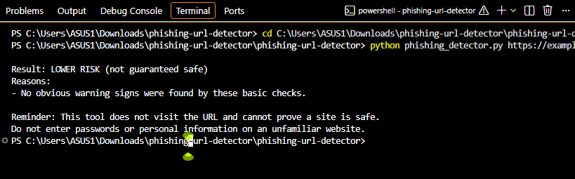
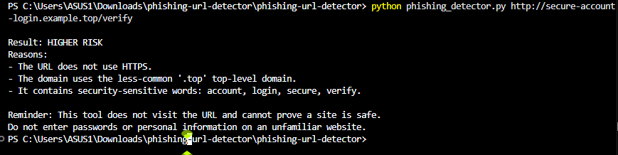

# Phishing URL Detector (Python)

A beginner-friendly cybersecurity project that analyzes URLs for common phishing warning signs using Python-based heuristic techniques.

## Project Overview

Phishing attacks use deceptive URLs to trick users into revealing sensitive information such as passwords and banking details.

This project checks URLs for common suspicious patterns and provides a risk assessment with explanations.

## Features

* Detects IP-address-based URLs.
* Identifies commonly used URL shorteners.
* Flags suspicious keywords such as `login`, `verify`, and `password`.
* Checks unusually long URLs and excessive subdomains.
* Identifies URLs without HTTPS.
* Flags selected uncommon top-level domains.
* Explains the warning signs behind each result.

## Technologies Used

* Python 3.9+
* urllib.parse
* argparse
* Regular expressions
* Standard Python libraries

## Installation

Clone the repository:

```bash
git clone https://github.com/Vinusha-03/phishing-url-detector.git
```

Open the project folder:

```bash
cd phishing-url-detector
```

No third-party packages are required.

## Usage

Check a URL:

```bash
python phishing_detector.py https://example.com
```

Or run without an argument and enter a URL when prompted:

```bash
python phishing_detector.py
```

## Test Examples

```bash
python phishing_detector.py https://example.com
python phishing_detector.py http://192.0.2.10/login/verify
python phishing_detector.py http://secure-account-login.example.top/verify
```

The IP address in the second example is reserved for documentation and is not a real target.

## Sample Results

The tool provides different risk assessments based on the warning signs detected:

* **LOWER RISK:** No obvious warning signs were found.
* **HIGHER RISK:** One or more suspicious URL patterns were detected.

These results are heuristic assessments, not proof that a website is safe or malicious.

## How It Works

1. Accepts a URL through command-line arguments or user input.
2. Parses the URL using Python's `urllib.parse`.
3. Checks for suspicious URL patterns.
4. Evaluates the detected warning signs.
5. Displays a risk assessment and the reasons behind it.

## Project Structure

```text
phishing-url-detector/
│
├── phishing_detector.py
├── README.md
└── .gitignore
```

## Important Limitations

This is an educational project, not a production phishing-detection service.

* It does not visit or open URLs.
* It does not check website reputation.
* It does not inspect webpage content.
* It does not use machine learning.
* A lower-risk result does not guarantee that a website is safe.

Never enter sensitive information on an unfamiliar website just because this tool reports lower risk.

## Concepts Learned

* URL parsing
* Python functions and sets
* Input validation
* Conditional logic
* Command-line arguments using `argparse`
* Cybersecurity awareness
* Heuristic-based detection

## Author

**Vinusha Dmello**

GitHub: https://github.com/Vinusha-03
## 📸 Screenshots

### Lower Risk URL Detection


### Higher Risk URL Detection

